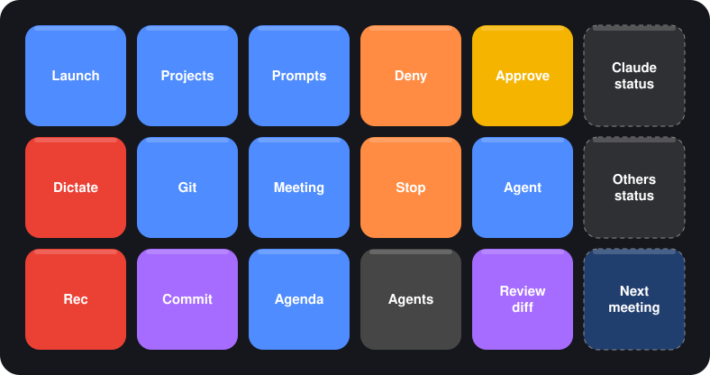

# Agent Deck

Mirabox HSV293S (or any OpenDeck device) as a control surface for coding agents
(Claude Code, Codex, OpenCode, Pi) running in [herdr](https://herdr.dev).

## Note
This layout fits exactly my use case and my workflow, you can ask your agents to adapt it to your needs.

## Layout

On the Mirabox HSV293SV3 OpenDeck shows a 6x3 grid: 5x3 pressable keys plus a
display-only screen in the right column. The screen shows two status tiles (Claude; Codex, OpenCode and Pi)
and, in the bottom row, the time with a countdown to your next Outlook meeting, in every profile.
When a meeting starts and the recorder is idle, the deck switches to a reminder with an animated Rec key. Press Rec to start recording, or press any blank key to dismiss the reminder without recording. Either choice returns to Home. To test it without a real meeting: `echo started > ~/.claude/deck-status/test-meeting` (delete the file to stop).



The deck is meant to sit left of the keyboard: Dictate, Rec and Mic are in the far-left column, Vol + / Vol - next to them.
Regenerate the image after changing the layout with `node scripts/layout-svg.mjs`.

| Profile | Keys |
|---|---|
| **Home** | Dictate, Vol + (speaker level), Launch, Projects, Prompts · Rec, Vol −, Git, Meeting, Agent · Mic (mute/unmute the default microphone, red when muted), Teams Share (opens the window picker), Agenda, Agents (overall status, press to focus the most urgent), Review diff |
| **Launch** | start a new agent in a pane next to the focused one; VS Code on the focused folder or on each project |
| **Projects** | open/focus a herdr workspace per project (from `deck.local.mjs`) |
| **Prompts** | canned prompts typed into the focused agent, plus the pi skills `team-activity` (for yourself: yesterday / last week) and `worktime-calc`, which run in the background with GLM 5.3 Flash and open the answer as markdown. Work-time keys may define `dialog`: a small native prompt asks for a value (e.g. which period) before the run |
| **Agenda** | next Outlook meetings (time + title); press one and GLM 5.3 Flash (opencode, background) writes a briefing and opens it |
| **Agent** | Approve, Stop, mode toggle, plus one tile per running herdr agent (project, kind, state; press to jump to it), plus usage-limit tiles at the end: Claude weekly, Codex weekly, OpenCode Go monthly (% left, time to reset; green/amber/red; press to refresh). "More": Deny, Ctrl+C, clear/compact/model/resume (mapped per agent), Dictate AI / Cancel |
| **Meeting** | Rec (toggle), Summary (re-run the summary), last transcript, meetings folder |
| **Git** | status, diff, log, branches, pull, PR in browser (helper pane), commit / open PR (via agent) |

Status tiles: spinning green ring = working, yellow = waiting for approval, grey = idle, "Off" = none running.
Dictate keys toggle [Handy](https://github.com/cjpais/Handy) (`handy --toggle-transcription`); the text is typed into the focused window.
Meetings: Rec records the mic (plus an optional loopback device for system audio) with ffmpeg in
5-minute 16 kHz WAV parts under `~/Documents/Meetings/<date_time>/`; Stop transcribes them locally with
`handy --transcribe-file` into `transcript.md`, re-cuts the audio at the nearest pause around each 5-minute mark (`splitAtSilence: false` keeps fixed cuts), then cleans each part the way Handy does (drops fillers like "um", collapses stutters, fixes names listed in `meetings.vocabulary`; disable with `cleanTranscript: false`). If Rec is pressed while an Outlook calendar meeting is in progress, the transcript and summary use that meeting's title and include its organizer and attendees. After transcription OpenCode (`opencode run -m opencode-go/glm-5.3-flash`, headless) writes `summary.md` next to it; change the model with `summaryModel` in `meetings`. Set `meetings.vault` to copy only that Markdown summary into an Obsidian/Git folder; audio and the full transcript always stay in the local recordings folder. Tell participants you are recording.
Agenda reads the published Outlook calendar (ICS link, set `calendar` in `deck.local.mjs`; it is private, so that file stays uncommitted).
Other decks: set `device` (and optionally `screen`) in `deck.local.mjs`.

## How it works

- `agentdeck.sdPlugin/` — OpenDeck plugin (Node 22, no dependencies). Polls `herdr agent list`,
  and acts through `herdr agent focus|send-keys|prompt|start`, `herdr pane split|run`, `herdr workspace`.
- `hooks/deck-hook.mjs` — Claude Code hooks write `~/.claude/deck-status/<session>.json`, so Claude
  sessions outside herdr (desktop app) also light up the Claude key.
- `deck.config.mjs` — layout and key behavior (shared). `deck.local.mjs` — projects and terminal app
  for this machine (not committed; start from `deck.local.example.mjs`).
- `scripts/install.mjs` — closes OpenDeck, installs the plugin, generates profiles for every connected
  deck, registers hooks, restarts OpenDeck. Previous profiles are backed up next to them.

## Install

Requirements: ffmpeg (for meetings), OpenDeck ≥ 2.5 with the device plugin (`opendeck-akp153` for HSV293S), Node ≥ 22, herdr
with the integrations for your agents (`herdr integration install claude|codex|opencode|pi`).

```sh
cp deck.local.example.mjs deck.local.mjs   # edit projects + terminal
./install.sh                                # macOS
```

```powershell
Copy-Item deck.local.example.mjs deck.local.mjs
.\install.ps1                               # Windows
```

Re-run the installer after editing the config. `--no-hooks` / `-NoHooks` leaves `~/.claude/settings.json` alone.

## Windows notes

- The plugin starts through `bin/main.js` with OpenDeck's Node.js runtime.
- `terminal` in `deck.local.mjs` is a window title for `AppActivate` (e.g. `Windows Terminal`).
- The device plugin author lists Windows as "zero effort" support.
